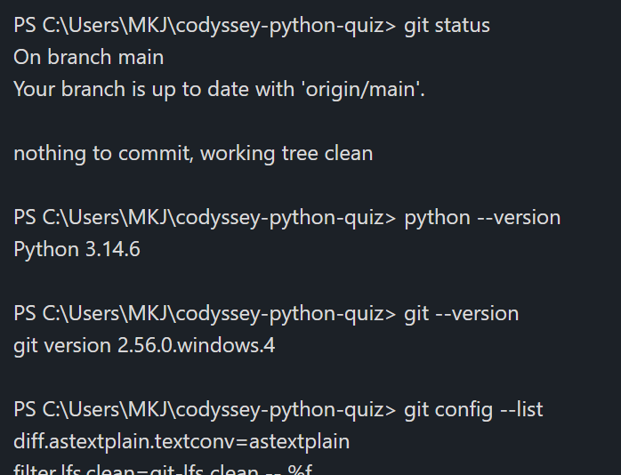
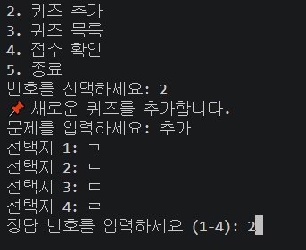
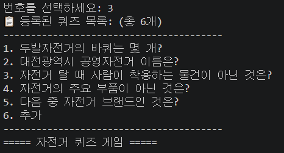
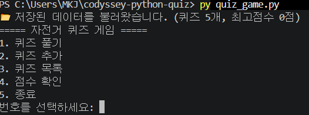
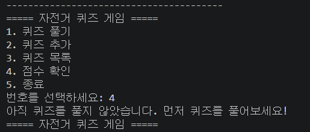

# 🚴 자전거 상식 퀴즈 게임

## 프로젝트 개요
터미널에서 동작하는 자전거 상식 퀴즈 게임입니다.
메뉴에서 번호를 선택해 퀴즈를 풀고, 직접 문제를 추가하며, 최고 점수를 기록할 수 있습니다.
프로그램을 종료해도 퀴즈와 최고 점수가 `state.json` 파일에 저장되어 다음 실행 때 그대로 이어집니다.

## 퀴즈 주제와 선정 이유
- 주제: 자전거에 관한 가벼운 상식

자전거는 남녀노소 누구나 접해본 친숙한 교통수단이라 부담 없이 즐길 수 있고,
안전 상식까지 자연스럽게 익힐 수 있어 주제로 선정했습니다.
자전거 안전사고가 날 뻔했던 경험과 공기주입 시 당황했던 기억을 떠올리면서 문제를 만들었습니다.

## 실행 환경
- OS: Windows
- 편집기 / 터미널: VS Code / PowerShell
- Python: Python 3.14.6
- Git: git version 2.56.0.windows.4
- 외부 라이브러리 없음 (표준 라이브러리 `json`, `pathlib`만 사용)

## 실행 방법

```bash
git clone https://github.com/sidebi752/codyssey-python-quiz.git
cd codyssey-python-quiz
python quiz_game.py
```

## 기능 목록
| 메뉴 | 기능 | 설명 |
|---|---|---|
| 1 | 퀴즈 풀기 | 저장된 문제를 차례로 출제하고 정답 여부를 알려 준 뒤, 100점 만점으로 환산한 결과를 보여 줍니다. 퀴즈가 없으면 안내 후 메뉴로 돌아갑니다. |
| 2 | 퀴즈 추가 | 문제, 선택지 4개, 정답 번호(1~4)를 입력받아 등록하고 바로 파일에 저장합니다. |
| 3 | 퀴즈 목록 | 등록된 문제를 '[번호] 문제' 형태로 보여 줍니다. 퀴즈가 없으면 안내합니다. |
| 4 | 점수 확인 | 최고 점수를 보여 줍니다. 아직 푼 적이 없으면 안내합니다. |
| 5 | 종료 | 데이터를 저장한 뒤 종료합니다. |

### 입력 처리 기준
숫자를 입력받는 모든 곳(메뉴 선택, 정답 입력, 정답 번호 등록)에서 같은 기준을 적용합니다.
- 입력 앞뒤 공백은 제거하고 처리합니다.
- 빈 입력, 숫자가 아닌 입력, 허용 범위 밖 숫자는 안내 문구를 보여 주고 다시 입력받습니다.

## 파일 구조

```
codyssey-python-quiz/
├── quiz_game.py      # 실행 파일 (도구 함수, Quiz·QuizGame 클래스)
├── state.json        # 퀴즈 목록과 최고 점수 저장 파일
├── README.md         # 프로젝트 설명
├── .gitignore        # Git 관리 제외 목록
└── docs/screenshots/ # 실행 화면 캡처
```

## 코드 구조

### 클래스 설계
| 클래스 | 맡은 일 | 속성 | 메서드 |
|---|---|---|---|
| `Quiz` | 퀴즈 1개를 표현 | `question`, `choices`, `answer` | `show()` 문제 출력, `check()` 정답 확인, `to_dict()` 저장용 변환 |
| `QuizGame` | 게임 전체를 관리 | `quizzes`, `best_score` | `show_menu()`, `run()`, `play()`, `add_quiz()`, `list_quizzes()`, `show_score()`, `load()`, `save()` |

기본 퀴즈 5개는 `create_default_quizzes()` 함수가 `Quiz` 객체로 만들어 돌려줍니다.

### 클래스를 사용한 이유
함수만 쓰면 문제·선택지·정답을 따로따로 변수에 담아 들고 다녀야 합니다.
클래스는 데이터와 그 데이터를 다루는 동작을 한 덩어리로 묶어 주므로,
퀴즈가 늘어나도 `Quiz` 객체를 리스트에 추가하기만 하면 됩니다.
처음엔 함수로 하드코딩을 하려 했는데, 클래스 형태로 체계화하니 문제 추가 및 삭제, 저장 파일 불러오기 등 관리가 깔끔해서 좋았습니다.

### 입력 검증과 파일 입출력의 분리
| 책임 | 담당 | 기준 |
|---|---|---|
| 입력 검증 | `get_text()`, `get_number()` | 사용자 입력을 받는 모든 곳은 이 두 함수만 거칩니다. 잘못된 입력은 여기서 걸러져 밖으로 나가지 않습니다. |
| 파일 입출력 | `QuizGame.load()`, `QuizGame.save()` | `state.json`을 직접 여는 코드는 이 두 메서드에만 있습니다. |
| 게임 진행 | `play()`, `add_quiz()` 등 | 검증이 끝난 값만 받아 쓰고, 저장이 필요하면 `save()`를 호출합니다. |

이렇게 나누면 입력 규칙이 바뀔 때는 도구 함수만, 저장 방식이 바뀔 때는 `load()`/`save()`만 고치면 됩니다.

## 데이터 파일 설명 (state.json)
- 경로: 프로젝트 루트의 `state.json` (실행 파일과 같은 폴더)
- 역할: 퀴즈 목록과 최고 점수를 저장하고 불러오기
- 인코딩: UTF-8

### 스키마

```json
{
  "quizzes": [
    {
      "question": "문제 내용",
      "choices": ["선택지1", "선택지2", "선택지3", "선택지4"],
      "answer": 2
    }
  ],
  "best_score": 0
}
```

| 필드 | 형태 | 설계 의도 |
|---|---|---|
| `quizzes` | 리스트 | 퀴즈 개수가 늘어나도 순서대로 담을 수 있도록 리스트로 둡니다. |
| `question` | 문자열 | 문제 문장 |
| `choices` | 문자열 4개의 리스트 | 선택지 순서가 곧 번호(1~4)가 되도록 리스트로 둡니다. |
| `answer` | 정수 1~4 | 정답을 글자가 아닌 번호로 관리해 입력값과 바로 비교합니다. |
| `best_score` | 정수 0~100 | 문제 수가 달라져도 비교할 수 있도록 맞힌 개수가 아닌 100점 환산 점수로 저장합니다. |

퀴즈 하나가 문제·선택지·정답을 함께 가지므로, `quizzes` 안에 딕셔너리를 넣는 중첩 구조를 택했습니다.
이 구조는 `Quiz` 클래스의 속성과 1:1로 대응해, 불러올 때 그대로 객체로 만들 수 있습니다.

### 읽고 쓰는 시점
| 시점 | 동작 |
|---|---|
| 프로그램 시작 (`QuizGame.__init__`) | `load()`로 `state.json`을 읽습니다. |
| 퀴즈 추가 직후 | `save()` |
| 최고 점수 갱신 직후 | `save()` |
| 5번 종료 직전 | `save()` |
| Ctrl+C / 입력 종료 시 | `save()` 후 종료 |

### JSON을 선택한 이유
- 사람이 메모장으로 열어 바로 읽고 고칠 수 있습니다.
- 리스트와 딕셔너리 구조가 Python 자료형과 그대로 대응해, 표준 라이브러리 `json`만으로 저장하고 불러올 수 있습니다.
- 간단한 코드 몇 줄만 추가해도 파일에 오류가 있을 경우 기본 파일로 불러와주어서 보안 측면에서 훌륭하다고 느꼈습니다.

### JSON 저장 방식의 한계
- 저장할 때마다 파일 전체를 다시 쓰고, 불러올 때 전체를 메모리에 올립니다. 퀴즈가 수만 개로 늘면 느려지고 메모리를 많이 씁니다.
- 여러 프로그램이 동시에 쓰면 내용이 덮어써질 수 있습니다.
- 데이터가 커지면 SQLite 같은 데이터베이스(필요한 부분만 읽고 쓰는 저장 방식)로 바꾸는 것이 대안입니다.

## 예외 처리
| 상황 | 동작 |
|---|---|
| Ctrl+C(`KeyboardInterrupt`) / 입력 종료(`EOFError`) | 안내 문구 출력 → 저장 → 종료 |
| `state.json` 없음 (첫 실행) | 기본 퀴즈 5개로 시작 |
| `state.json` 손상 (`JSONDecodeError`, `KeyError`, `TypeError`) | 안내 문구 출력 → 기본 퀴즈 5개로 초기화 |
| 저장 실패 (`OSError`) | 운영체제가 반환한 구체적인 에러 메시지나 에러 번호를 변수에 담아 남김 |

파일 작업은 디스크 공간 부족, 쓰기 권한 없음, 파일 내용 손상처럼 코드 밖의 이유로 실패할 수 있어서
`load()`와 `save()` 안에서 `try/except`로 감쌌습니다.

### state.json이 손상되었을 때
- 프로그램은 손상된 내용을 버리고 기본 퀴즈로 시작합니다. 이후 저장이 일어나면 손상된 파일은 새 내용으로 덮어써집니다.
- 직접 초기화하려면 `state.json`을 지우고 다시 실행합니다.
- 저장소에 올라간 기본 상태로 되돌리려면 `git restore state.json`을 실행합니다.
- 현재 별도의 백업 파일은 만들지 않습니다. 추가한 퀴즈를 보존하려면 `state.json`을 미리 복사해 두어야 합니다.

## Git 작업 기록

### 커밋 규칙
- 기능 하나가 동작하는 단위로 커밋합니다. (메뉴, Quiz 클래스, 퀴즈 풀기, 저장 등)
- 메시지는 `머리말: 변경 요약` 형식으로 씁니다.

| 머리말 | 뜻 | 예시 |
|---|---|---|
| `Feat` | 기능 추가 | `Feat: state.json 저장 및 불러오기 구현` |
| `Fix` | 오류 수정 | `Ctrl+C, EOFError(입력이 갑자기 끝날 때 나는 오류) 처리` |
| `Refactor` | 동작은 그대로, 구조만 정리 | `Refactor: QuizGame 클래스로 구조 정리` |
| `Docs` | 문서 수정 | `README 1차 평가 후 수정` |
| `Chore` | 기능과 무관한 정리 | `.gitignore, README.md 기본 틀` |

### 브랜치와 병합
| 브랜치 | 작업 내용 | 병합 방법 |
|---|---|---|
| `feature/add-quiz` | 기본 퀴즈 5개, QuizGame 구조 정리, 퀴즈 풀기, 입력 검증 | 로컬 `git merge --no-ff` |
| `feature/add-quiz` | 퀴즈 추가 기능 | 정답 입력 검증 및 재입력 처리 |
| `feature/save-load` | state.json 저장·불러오기, 자동 저장 | 로컬 `git merge --no-ff` |

브랜치를 나누면 `main`은 항상 실행되는 상태로 두고, 새 기능은 따로 만들다가 완성된 뒤에만 합칠 수 있습니다.
병합할 때 `--no-ff` 옵션을 써서, 어느 커밋들이 한 기능으로 묶여 들어왔는지 기록에 남겼습니다.
브랜치를 나눠 작업하니 틀려도 원본이 있다는 사실에 안심이 되는 한 편, 바로 반영이 안되길래 왜 안되지 하고 헷갈리기도 했습니다.

### 커밋 기록

```
* 28e5747 (HEAD -> main, origin/main, origin/HEAD) Feat: Ctrl+C 및 EOF 입력 시 안전 종료 처리
*   c8f4fe6 Merge: state.json 저장/불러오기 기능 병합
|\  
| * 01592b1 (origin/feature/save-load, feature/save-load) Feat: 퀴즈 추가·점수 갱신·종료 시 자동 저장
| * cf7eee1 Feat: state.json 저장 및 불러오기 구현 수정
| * 00b0d37 Feat: state.json 저장 및 불러오기 구현
|/  
* 85aacce Feat: 퀴즈 추가 기능 재구현
*   fa041f8 Merge branch 'feature/add-quiz'
|\  
| * 351af87 (origin/feature/add-quiz, feature/add-quiz) Feat: 정답 입력 검증 및 재입력 처리
```

### clone / pull 실습
1. 다른 폴더에 저장소를 복제했습니다.
   ```bash
   git clone https://github.com/sidebi752/codyssey-python-quiz.git quiz-clone
   ```
2. 복제한 폴더에서 README에 한 줄을 추가하고 `add` → `commit` → `push` 했습니다.
3. 원래 폴더에서 `git pull`로 변경 사항을 가져와 반영된 것을 확인했습니다.

clone은 처음으로 복사해 올 때, pull은 이미 로컬에 있는 것에 저장소의 최신 버전을 덮어 씌울 때 사용합니다.

## 요구사항이 바뀔 때 고칠 곳
| 바꾸려는 것 | 고칠 곳 |
|---|---|
| 기본 퀴즈 내용이나 개수 | `create_default_quizzes()` |
| 메뉴 항목 추가 | `QuizGame.show_menu()`, `QuizGame.run()`의 분기, 메뉴 번호 범위 |
| 입력 검증 규칙 | `get_text()`, `get_number()` |
| 퀴즈에 새 속성 추가 (예: 힌트) | `Quiz.__init__()`, `Quiz.to_dict()`, `QuizGame.load()`, `QuizGame.add_quiz()`, README의 스키마 |
| 점수 계산 방식 | `QuizGame.play()`, `QuizGame.show_score()` |
| 저장 파일 위치나 형식 | 맨 위의 `STATE_FILE`, `QuizGame.load()`, `QuizGame.save()` |

## 실행 화면
| 화면 | 캡처 |
|---|---|
| 개발 환경 |  |
| 퀴즈 추가 |  |
| 퀴즈 목록 |  |
| 퀴즈 풀기 |  |
| 점수 확인 |  |

## 어려웠던 점과 해결

브랜치 이름을 잘못 써서 push가 안 됐던 일
    -> 확인하고 다시 push해서 해결!

병합 중 Vim이 열렸던 일
    -> ...merge -m ".." 해야 하는데 -m 이후의 메세지를 쓰지 않음. Vim으로 병합 기록을 쓰라는 창이 뜸. :wq 하고 나와서 다시 입력.

load()가 두 번 호출되던 일
    -> "저장된 데이터를 불러왔습니다."라는 메세지가 2번씩 뜸. load()가 class __init__ 과 맨 마지막 run에 중복으로 있는 것을 확인 후 마지막 부분에 중복으로 존재하던 load를 지움.

## 배운 점

게임 만드는 게 쉬운 게 아니구나.